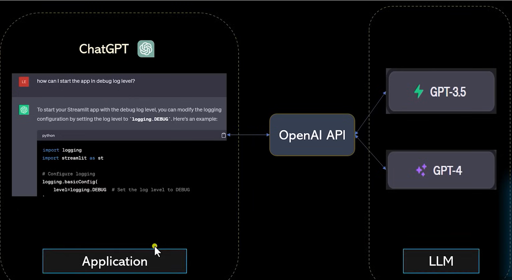
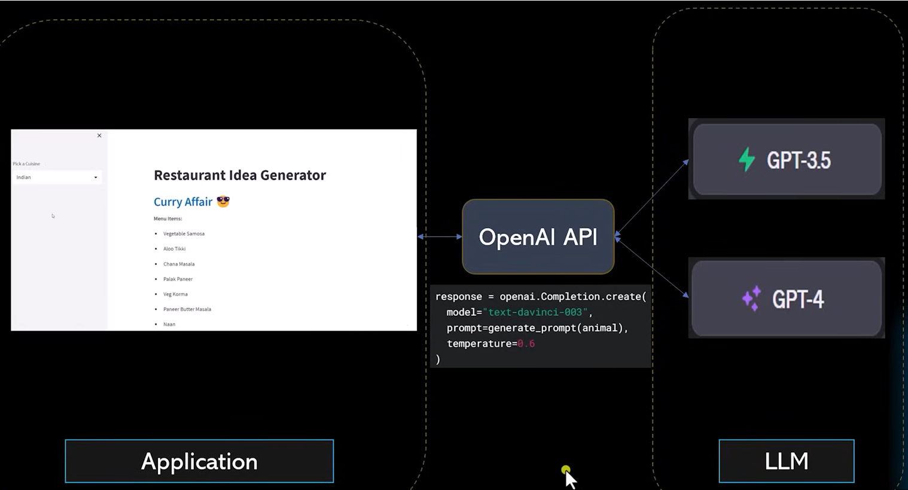
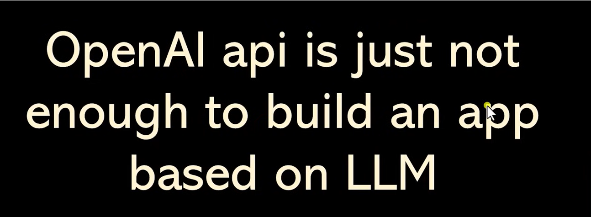
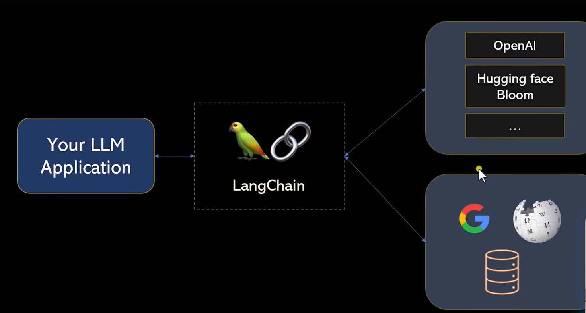
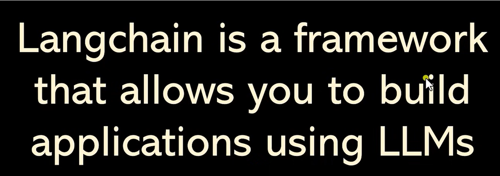
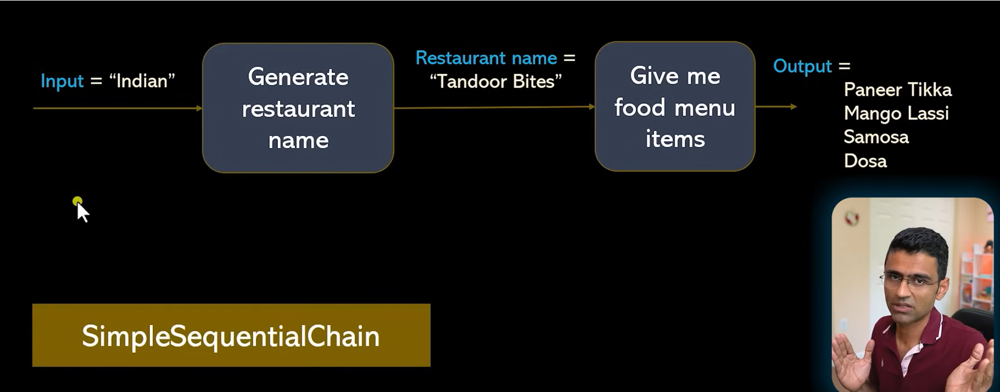
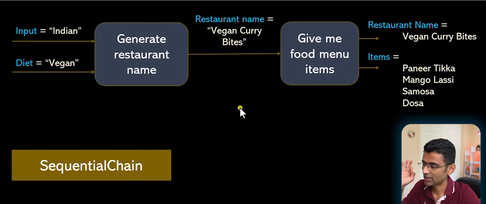
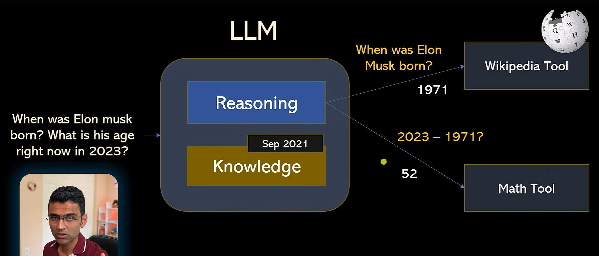

# Restaurant Idea Generator (LangChain + Mistral + Streamlit)

A small learning project that shows how to build an application on top of a Large Language Model (LLM) using **LangChain**.

It contains two demos:

1. **Restaurant Idea Generator** – a Streamlit web app. You pick a cuisine and it invents a fancy restaurant name and a menu. This demonstrates **chains**.
2. **Agent demo** – a script where the LLM decides by itself to look things up on Wikipedia. This demonstrates **agents and tools**.

> The original tutorial used OpenAI. This project uses **Mistral** (`ChatMistralAI`) and the **modern LangChain 1.x syntax**. Old OpenAI-era code is kept in comments (marked `OLD:`) so you can compare old and new.

---

## Table of contents

1. [Concepts (notes)](#1-concepts-notes)
2. [Project structure](#2-project-structure)
3. [File-by-file explanation](#3-file-by-file-explanation)
4. [Setup and running](#4-setup-and-running)
5. [Old vs modern LangChain syntax](#5-old-vs-modern-langchain-syntax)
6. [Troubleshooting](#6-troubleshooting)

---

## 1. Concepts (notes)

### 1.1 How a normal LLM application works

An application (for example ChatGPT, or our restaurant app) sends a prompt to an LLM provider's API. The API runs a model (GPT-3.5, GPT-4, Mistral...) and sends text back.



Our restaurant app is the same idea: the Streamlit page is the *application*, and the model behind the API is the *LLM*.



### 1.2 Why the API alone is not enough

Calling the API once is easy. A real application needs more: chaining several prompts together, reusing prompt templates, connecting to Google / Wikipedia / databases, switching model providers, and so on.



### 1.3 What LangChain is

**LangChain is a framework that lets you build applications using LLMs.** It sits between your application and (a) the LLM providers and (b) external data and tools.





Because of this layer, changing from OpenAI to Mistral in this project only required changing **one line** (the `llm = ...` definition).

### 1.4 Sequential chains

A **chain** connects several steps so that the output of one step becomes the input of the next.


**Simple version – one input, one output.** Input `"Indian"` produces a restaurant name (`"Tandoor Bites"`), which is fed into a second prompt that produces menu items. You only see the final output.



**General version – many inputs and many outputs.** Here we pass several inputs (cuisine and diet) and we want **both** the restaurant name and the menu items back, not only the last step's output.



This second form is what our app uses: the UI needs the name (as a heading) **and** the menu items (as a list).

> In old LangChain this was done with `LLMChain`, `SimpleSequentialChain` and `SequentialChain` (with `output_key`). Those classes were removed in LangChain 1.x. The modern replacement is **LCEL** (the `|` pipe operator) plus `RunnablePassthrough.assign(...)`. See [section 5](#5-old-vs-modern-langchain-syntax).

#### What is LCEL?

**LCEL stands for LangChain Expression Language.** It is LangChain's way of building a pipeline by joining steps with the `|` (pipe) operator. Read `|` as "then":

```python
name_chain = prompt | llm | StrOutputParser()
```

This means: fill in the prompt, then send it to the LLM, then turn the reply into a plain string. Every step (prompt, model, output parser, even a plain lambda) is a "Runnable". It takes an input, gives an output, and the output feeds the next step. All Runnables share the same methods: `.invoke()` for one input, `.stream()` for streaming and `.batch()` for many inputs.

Two chains can be joined into one bigger chain:

```python
chain = (
    name_chain                                   # cuisine -> restaurant name
    | StrOutputParser()                          # message -> plain text
    | (lambda name: {"restaurant_name": name})   # wrap text into the dict the next prompt expects
    | menu_chain                                 # restaurant name -> menu items
)
```

The lambda is needed because `menu_chain`'s prompt expects `{"restaurant_name": ...}`, but the previous step gives a plain string.

**Why do we need `StrOutputParser()` here? Why not send the output of `name_chain` straight to `menu_chain`?**

Because `name_chain` (`prompt | llm`) does not return text. A chat model returns an **`AIMessage` object**, not a string:

```
AIMessage(content='Tandoor Bites', response_metadata={...}, usage_metadata={...}, ...)
```

The text is inside `.content`. The other fields are metadata such as token counts. `StrOutputParser()` pulls out just the text, so you get `"Tandoor Bites"`.

You cannot send the message straight on, because:

1. `menu_chain` starts with a prompt that has a `{restaurant_name}` slot. A prompt template takes a dict like `{"restaurant_name": "..."}` and fills the slot.
2. If you pass the `AIMessage` object, the prompt does not know what to put in that slot. You get an error, or the slot is filled with the whole message repr (`content='Tandoor Bites' additional_kwargs={} ...`) instead of just the name.

So the two middle steps do two jobs:

- `StrOutputParser()` turns the message into plain text.
- `lambda name: {"restaurant_name": name}` puts that text into the dict the next prompt expects.

In the final `generate_restaurant_name_and_items` function, `name_chain` is `prompt | llm | StrOutputParser()`, so the parser is already built in. That is why `RunnablePassthrough.assign(restaurant_name=name_chain)` receives a plain string.

### 1.5 Agents and tools

An LLM is good at **reasoning** but its **knowledge is frozen** at training time and it cannot act in the world. The fix is to give it **tools**, such as a flight-booking plugin.


An **agent** is an LLM that decides *which tool to call and with what input*. For the question *"When was Elon Musk born? What is his age right now in 2023?"*:

1. The LLM reasons that it needs the birth year, so it calls the **Wikipedia tool** and gets `1971`.
2. It then needs arithmetic, so it asks a **math tool** `2023 - 1971` and gets `52`.
3. It combines both results into the final answer.



---

## 2. Project structure

```
pavan_langchain/
├── .env                  # secret API key (never commit this)
├── requirements.txt      # Python dependencies
├── langchain_helper.py   # the LLM logic (chains)
├── main.py               # the Streamlit web UI
├── agent.py              # the standalone agent demo
├── images/               # diagrams used in this README
└── README.md             # this file
```

How the pieces connect:

```
Browser  <->  main.py (Streamlit UI)  ->  langchain_helper.py (chains)  ->  Mistral API
                                                      agent.py (separate)  ->  Mistral API + Wikipedia
```

---

## 3. File-by-file explanation

### `.env`

Holds your secret key:

```
MISTRAL_API_KEY=your-key-here
```

`python-dotenv` loads it when the program starts, so the key never appears in the code. **Do not commit this file or share it.**

### `requirements.txt`

The list of packages to install:

| Package | Why it is needed |
|---|---|
| `langchain` | Core framework, provides `create_agent` |
| `langchain-core` | Prompts, output parsers, runnables (the `\|` pipe) |
| `langchain-mistralai` | `ChatMistralAI`, the connector to Mistral models |
| `langchain-community` | Community integrations, used here for the Wikipedia tool |
| `mistralai` | Mistral's own client library |
| `wikipedia` | Python package the Wikipedia tool uses |
| `python-dotenv` | Loads `.env` |
| `streamlit` | Builds the web UI |

### `langchain_helper.py`: the LLM logic

This is the "brain" of the web app. It exposes one function, `generate_restaurant_name_and_items(cuisine)`.

Step by step:

1. **Load the key**: `load_dotenv()` reads `.env`.
2. **Create the model**:
   ```python
   llm = ChatMistralAI(model="mistral-small-latest", temperature=0.6, api_key=os.getenv("MISTRAL_API_KEY"))
   ```
   `temperature` controls creativity (0 = predictable, higher = more varied). This is the only place that knows which LLM provider is used.
3. **Define two prompt templates** (`PromptTemplate`):
   - `prompt`: takes `{cuisine}` and asks for one fancy restaurant name.
   - `prompt_items`: takes `{restaurant_name}` and asks for menu items as a comma-separated string.
4. **Build two small chains** using the pipe operator:
   ```python
   name_chain = prompt | llm | StrOutputParser()
   menu_chain = prompt_items | llm | StrOutputParser()
   ```
   Read `|` as "then": fill the prompt, then send it to the LLM, then convert the reply to a plain string. A chat model returns a message object, and `StrOutputParser` extracts the text from it.
5. **Join them** (this replaces `SequentialChain`):

This code runs two chains one after the other and returns both results. It replaces the old `SequentialChain`.

```python
chain = (
    RunnablePassthrough.assign(restaurant_name=name_chain)
    | RunnablePassthrough.assign(menu_items=menu_chain)
).pick(["restaurant_name", "menu_items"])

print(chain.invoke({"cuisine": "Italian"}))
```


**Step 1: `RunnablePassthrough.assign(restaurant_name=name_chain)`**

`RunnablePassthrough` passes its input through unchanged. Its `.assign()` method then does two things:

1. It runs `name_chain` on the incoming dict.
2. It returns the **same dict with one new key added**.

```
input:   {"cuisine": "Italian"}
output:  {"cuisine": "Italian", "restaurant_name": "Alba d'Oro"}
```

The original `cuisine` key stays. A plain `name_chain` would have thrown it away and given you only the name.

**Step 2: `| RunnablePassthrough.assign(menu_items=menu_chain)`**

The `|` sends step 1's output into this step. It does the same thing again: it runs `menu_chain` on the dict, then adds a `menu_items` key.

Here the pipe is where the connection happens. `menu_chain`'s prompt needs `{restaurant_name}`, and step 1 has already put that key in the dict, so it finds it.

```
input:   {"cuisine": "Italian", "restaurant_name": "Alba d'Oro"}
output:  {"cuisine": "Italian", "restaurant_name": "Alba d'Oro", "menu_items": "Pizza, Lasagna, Tiramisu"}
```

**Step 3: `.pick(["restaurant_name", "menu_items"])`**

By now the dict holds three keys, but the app only needs two. `.pick()` keeps the listed keys and drops the rest (here, `cuisine`).

```
{"restaurant_name": "Alba d'Oro", "menu_items": "Pizza, Lasagna, Tiramisu"}
```

**Step 4: `chain.invoke({"cuisine": "Italian"})`**

`.invoke()` starts the whole chain with that input dict. `print(...)` shows the final dict from step 3.

**About the large commented blocks in this file:** they are intentional learning notes. They show the same idea written step by step (direct call, then the old `LLMChain`/`SequentialChain` style, then the modern style) so you can see how the code evolved. Only the function at the bottom is actually used by the app.

#### Switching to another LLM provider

Only two places in `langchain_helper.py` know about Mistral: the import (`from langchain_mistralai import ChatMistralAI`) and the `llm = ChatMistralAI(...)` definition. The prompts, chains and Streamlit UI work with any chat model, so changing provider means changing just those.

Every provider has its own LangChain package:

| Provider | Install | Import | Env key in `.env` |
|---|---|---|---|
| Mistral (current) | `langchain-mistralai` | `ChatMistralAI` | `MISTRAL_API_KEY` |
| OpenAI | `langchain-openai` | `ChatOpenAI` | `OPENAI_API_KEY` |
| Anthropic (Claude) | `langchain-anthropic` | `ChatAnthropic` | `ANTHROPIC_API_KEY` |
| Google Gemini | `langchain-google-genai` | `ChatGoogleGenerativeAI` | `GOOGLE_API_KEY` |
| Groq | `langchain-groq` | `ChatGroq` | `GROQ_API_KEY` |
| Ollama (local, no key) | `langchain-ollama` | `ChatOllama` | none |

**swap the class.** Example for OpenAI:

```python
from langchain_openai import ChatOpenAI
llm = ChatOpenAI(model="gpt-4o-mini", temperature=0.6, api_key=os.getenv("OPENAI_API_KEY"))
```


### `main.py`: the Streamlit web UI

A very small file that draws the page and calls the helper:

```python
st.title("Restaurant Name Generator")
cuisine = st.sidebar.selectbox("Pick a Cuisine", ["Italian", "Chinese", "Indian"])

if cuisine:
    response_data = langchain_helper.generate_restaurant_name_and_items(cuisine)
    st.header(response_data["restaurant_name"].strip())
    menu_items = response_data["menu_items"].strip().split(",")
    st.subheader("Menu Items")
    for item in menu_items:
        st.write(f"- {item}")
```

- The sidebar dropdown chooses the cuisine.
- Every time the user changes the dropdown, Streamlit re-runs the script, calls the helper, and shows the name as a header.
- The menu arrives as one comma-separated string, so `.split(",")` turns it into a list that is printed as bullet points.
- The block between `'''` quotes is an old hard-coded mock version, kept as a note. It does nothing.

### `agent.py`: the agent demo

A standalone script (not used by the web app) that demonstrates **agents and tools** (section 1.5):

```python
tools = [WikipediaQueryRun(api_wrapper=WikipediaAPIWrapper())]
agent = create_agent(model=llm, tools=tools)
result = agent.invoke({"messages": [{"role": "user", "content": "When was Elon Musk born? What is his age in 2023?"}]})
print(result["messages"][-1].content)
```

- `tools` is the list of things the agent may use. Here it is only Wikipedia.
- `create_agent` builds an agent (it runs on LangGraph underneath) that loops: think -> call a tool -> read the result -> think again -> answer.
- You send a list of chat `messages`, and the answer is the content of the **last** message.
- There is no separate "math tool" in the current file. The LLM does the subtraction itself. If you want a dedicated calculator, add a small function decorated with `@tool` (from `langchain_core.tools`) and put it in the `tools` list. The old `"llm-math"` tool no longer exists in LangChain 1.x.

Run it with `python agent.py`.

---

## 4. Setup and running

```bash
# 1. create and activate a virtual environment
python -m venv .venv
.venv\Scripts\activate          # Windows
# source .venv/bin/activate     # macOS / Linux

# 2. install dependencies
pip install -r requirements.txt

# 3. add your key to .env
echo MISTRAL_API_KEY=your-key-here > .env

# 4a. run the web app
streamlit run main.py

# 4b. or run the agent demo
python agent.py
```

---

## 5. Old vs modern LangChain syntax

| Task | Old (tutorial era) | Modern (this project) |
|---|---|---|
| LLM | `from langchain.llms import OpenAI` | `from langchain_mistralai import ChatMistralAI` |
| Call the model | `llm("text")` | `llm.invoke("text")` (returns a message, text in `.content`) |
| Prompt | `from langchain.prompts import PromptTemplate` | `from langchain_core.prompts import PromptTemplate` |
| One step | `LLMChain(llm=llm, prompt=prompt)` | `prompt \| llm \| StrOutputParser()` |
| Multi-step chain | `SequentialChain(..., output_key=...)` | `RunnablePassthrough.assign(key=chain)` |
| Choose outputs | `output_variables=[...]` | `.pick([...])` |
| Agent | `initialize_agent(tools, llm, agent=AgentType.ZERO_SHOT_REACT_DESCRIPTION)` | `create_agent(model=llm, tools=tools)` |
| Run agent | `agent.run("question")` | `agent.invoke({"messages": [...]})` |
| Tools | `load_tools(["wikipedia", "llm-math"])` | `WikipediaQueryRun(...)` or your own `@tool` functions |
| Wikipedia import | `langchain.utilities` | `langchain_community` |

---

## 6. Troubleshooting

- **`401 Unauthorized` or key errors**: check that `.env` exists in the project folder and the key name is `MISTRAL_API_KEY`.
- **`ModuleNotFoundError: langchain_community` or `wikipedia`**: run `pip install -r requirements.txt` inside the activated virtual environment.
- **Wikipedia returns an HTTP 429 or a JSON decode error**: Wikipedia rate-limits the library's default user agent. Add this before creating the tool:
  ```python
  import wikipedia
  wikipedia.set_user_agent("your-app-name/1.0 (your-contact)")
  ```
- **A deprecation warning about `langchain-community`**: it is safe to ignore for now. The package is being phased out in favour of standalone integration packages.
- **Agent answers with a different year than the question**: the model does not know today's date unless you give it a tool or tell it in the prompt.
